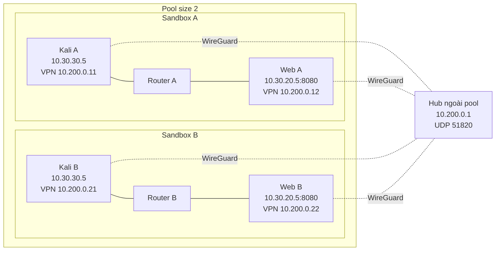

# Liên kết hai sandbox trong cùng pool

Sandbox Service dựng từng sandbox từ cùng topology. Thiết kế này bổ sung **mạng WireGuard cho cả bốn host** sau allocation; không ghép management networks hoặc sửa topology thành bốn host trong một sandbox.

## Điều kiện hạ tầng

- Hub Debian/Linux có kernel hỗ trợ WireGuard, user SSH có sudo, dành riêng cho pool thí nghiệm này. Có thể dùng hub sẵn trong mạng cơ quan; không bắt buộc mở ra Internet nếu cả bốn VM đã định tuyến đến được.
- Cả bốn VM phải đi đến endpoint hub qua router/cloud egress. Hub cần inbound UDP 51820 trong firewall của cloud và VM. Nếu deployment chặn egress hoặc không có đường tới hub, **repo một sandbox không tự giải quyết được**: quản trị viên cần cung cấp đường mạng.
- Dải `10.200.0.0/24` không trùng bất kỳ mạng hiện có, bao gồm management. Playbook kiểm tra route trên từng endpoint trước khi cấu hình tunnel. Bộ cấu hình này cố định dải đó; đổi dải cần sửa inventory, template và các kiểm tra cùng nhau.
- Tải/extract **management access** của từng sandbox trên máy instructor chạy Ansible Linux. Các IdentityFile được tham chiếu trong config phải tồn tại trên máy này. Đây là hai bundle riêng dù cả hai có host tên `attacker` và `server`.

## Thiết lập

1. Copy `inventory.example.yml` sang `inventory.yml` và điền hub thật. File thật được Git ignore.
2. Với hai host đội A, dùng management SSH config của sandbox A; với hai host đội B dùng config B. Giữ `ControlMaster=no` và `ControlPath=none` để SSH không tái dùng phiên tới host trùng tên ở sandbox khác.
3. Kiểm tra alias bằng lệnh instructor, ví dụ `ssh -F <A-management-config> attacker hostname`, tương tự cho B và cả hai server. Đối chiếu sandbox ID với bảng phân đội trên platform.
4. Chạy `ansible-playbook -i interconnect/inventory.yml interconnect/playbook.yml`.
5. Xác nhận ping giữa Kali A/B và HTTP từ mỗi phía đến web đối phương. Playbook kiểm tra từ cả bốn host, và hai web phải trả sandbox identity khác nhau.

Private key được sinh trên từng máy và lưu root-only tại `/etc/wireguard/idor-lab.key`. Key được giữ khi chạy lại playbook. Template được ghi root-only; các task chứa private key không in log. Không đưa key, SSH bundle hoặc flag vào repository/bản luận văn công khai.

## Đường đi của gói tin

Ví dụ Kali A gọi `http://10.200.0.22:8080`:

1. Route `10.200.0.0/24` đưa gói vào `wg-idor` của Kali A.
2. WireGuard mã hóa gói; endpoint đi tới hub qua router và egress của sandbox A.
3. Hub định tuyến `10.200.0.22/32` tới peer web B.
4. Web B nhận gói trên địa chỉ overlay của mình và trả theo đường ngược lại.

Không có route xuyên sandbox cho `10.30.20.0/24`, `10.30.30.0/24`, management CIDR hoặc default Internet route. IP private trùng nhau không gây chọn nhầm đích vì mỗi peer có IP overlay riêng. Hub chỉ chuyển tiếp ICMP, TCP 8080 và lưu lượng phản hồi liên quan giữa peer; không mở web qua IP công khai của hub.

WireGuard cần peer keys, AllowedIPs và endpoint; keepalive 25 giây được dùng cho các peer nằm sau NAT. Tham chiếu: [WireGuard Quick Start](https://www.wireguard.com/quickstart/).

## Kiểm chứng và dừng thực nghiệm

Trên mỗi VM, instructor có thể chạy `sudo wg show wg-idor` để xem handshake, `ip route get <IP-overlay-đối-phương>` để kiểm tra route, và các lệnh ping/curl trong README gốc. Không dùng `wg showconf` để chụp bằng chứng: nó có thể chứa private key.

Để dừng đường liên kết: chạy `ansible -i interconnect/inventory.yml lab_peers:lab_hub -b -m ansible.builtin.systemd_service -a 'name=wg-quick@wg-idor state=stopped enabled=false'`. PostDown gỡ các rule do cấu hình hub này tạo. Dừng tunnel không hoàn nguyên sysctl forwarding trên hub; chỉ sử dụng hub riêng, và nếu muốn hoàn nguyên thì operator khôi phục giá trị trước thực nghiệm đã ghi nhận.

Khi pool bị hủy/reallocate hoặc đổi revision, phải tạo lại bảng ánh xạ sandbox/đội và cấu hình liên kết. Không tái sử dụng key hoặc SSH config từ VM đã bị thay thế.
